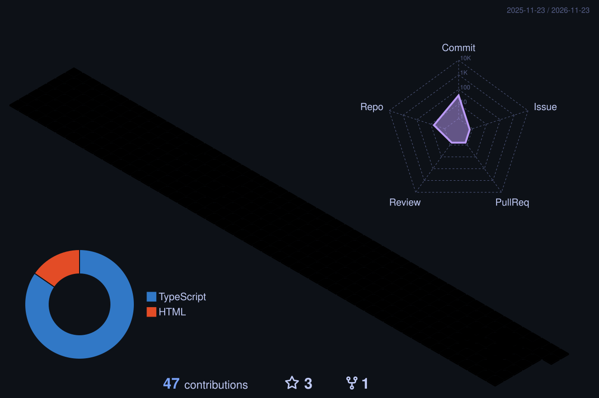

  <!-- Banner Animado Vetorial -->
  

    

  <!-- Links e Contatos Rápidos -->
  

    
    
    
  

---

### 👩‍💻 Sobre Mim

| Campo | Descrição |
| :--- | :--- |
| **🎓 Formação Acadêmica** | • Graduada em Engenharia da Computação • Pós-graduada em Desenvolvimento Web Full Stack • Pós-graduanda em Engenharia de Inteligência Artificial Aplicada |
| **👔 Atuação** | Desenvolvedora Full Stack / Front-End |
| **💬 Comunicação & Acessibilidade** | Fluente em Libras • Português • SI (Sinais Internacionais) • ASL • Inglês Técnico |
| **🌈 Pronomes** | Ela / Dela |

---

### 🛠️ Stack & Tecnologias

  

---

### 🌌 Mapa de commits

  <!-- Gerado por profile-3d.yml → branch output-3d (tema Tokyo Night) -->
  

---

### 📊 Estatísticas

  
  

 

  Construído com Next.js, TypeScript e automações via GitHub Actions.

